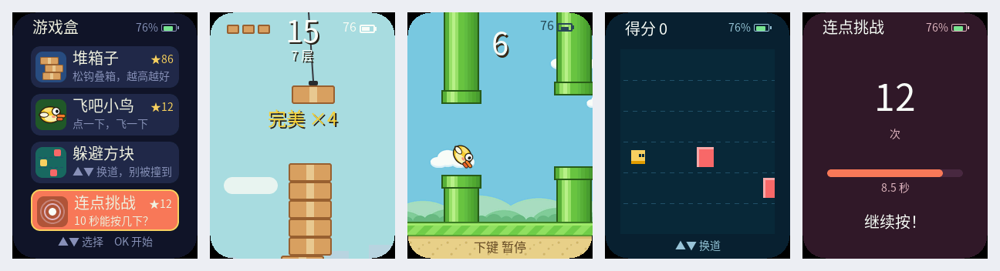

<p align="right">
  <strong>简体中文</strong> · <a href="README.md">English</a>
</p>

# 游戏盒（Game Box）

把 FoloToy AI Passport 变成一台三键小游戏掌机：开机进入游戏列表，选一个就能玩，
长按 OK 随时回到列表。所有游戏离线运行，不需要 Wi-Fi，也不需要手机。



<sub>截图由 `tools/render_gamebox_preview.sh` 在电脑上用与固件同版本的 LVGL 渲染真实代码得到，不是效果图。</sub>

本项目是独立仓库，基于 [FoloToy/ai-passport](https://github.com/FoloToy/ai-passport) 的开发板支持包与工程模板开发，
沿用其 MIT 许可证（见 [LICENSE](LICENSE)）。

## 游戏

| 游戏 | 玩法 | 按键 |
| --- | --- | --- |
| 堆箱子 | 吊车上的箱子来回摆动，看准时机松钩，把箱子叠成高塔。正中落下算「完美」，连续完美有加分和奖励命；塔重心偏太多会倒。 | OK / ▼ 松钩，▲ 暂停 |
| 飞吧小鸟 | Flappy Bird：点一下飞一下，穿过管道缝隙。三档难度各自记录最高分，按分数发铜 / 银 / 金 / 白金牌。 | OK / ▲ 扇翅，▼ 暂停 |
| 躲避方块 | 方块从右边飞来，换道躲开，越往后越快。 | ▲▼ 换道，OK 开始 |
| 连点挑战 | 10 秒内能按多少下 OK。 | OK 连按 |

每个游戏的最高分都会保存，并显示在游戏列表里。

## 操作

| 位置 | ▲ / ▼ | OK 单击 | OK 长按 |
| --- | --- | --- | --- |
| 游戏列表 | 移动选中项（一屏 4 个，更多时自动滚动） | 开始游戏 | — |
| 游戏中 | 由游戏决定 | 由游戏决定 | 弹出「返回游戏列表？」 |
| 确认框 | 继续玩 | 退出到游戏列表 | — |

右上角显示电量；30 秒无操作调暗背光，90 秒熄屏，熄屏时的第一次按键只负责唤醒。

## 构建与烧录

需要 ESP-IDF 5.5.3（见 [环境引导](docs/development/engineering/environment-setup.zh_CN.md)）。

```bash
source <ESP-IDF-v5.5.3 路径>/export.sh
./tools/validate.sh            # 仓库检查 + 主机测试 + 固件构建与合并镜像验证
```

验证通过的合并镜像位于 `build/FoloToy-AI-Passport-full.bin`，从 `0x0` 写入。注意：合并镜像会
重置 NVS（最高分清零）；想保留纪录时用分段烧录 `idf.py flash`。详见
[烧录与已存数据](docs/development/engineering/firmware-layout.zh_CN.md#烧录与已存数据)。

不连设备也能看界面：先构建一次固件（下载 LVGL 源码），再运行
`./tools/render_gamebox_preview.sh`，截图会写到 `build/gamebox_preview/`。

## 加入新游戏

平台提供统一的游戏接口、音效播放、最高分与存档、画布内存、共用中文字库和主机渲染预览。
接入步骤、按键约定与已移植游戏的对照表见
[游戏盒：平台结构与游戏接入指南](docs/development/engineering/game-box.zh_CN.md)。

## 素材与许可

- 中文字库是思源黑体 SC 的子集（SIL Open Font License 1.1），由 `tools/gamebox/gen_fonts.py` 生成。
- 飞吧小鸟的图片由 `tools/gamebox/gen_flappy_assets.py` 程序化绘制，没有第三方素材。
- 所有音效都由代码实时合成，不包含录音文件。

详见 [素材目录说明](assets/README.zh_CN.md)。

## 状态

固件构建、主机测试与主机渲染预览均已通过；**尚未在真机上完成验收**（帧率、按键手感、音效、
断电后纪录保留仍待确认）。
